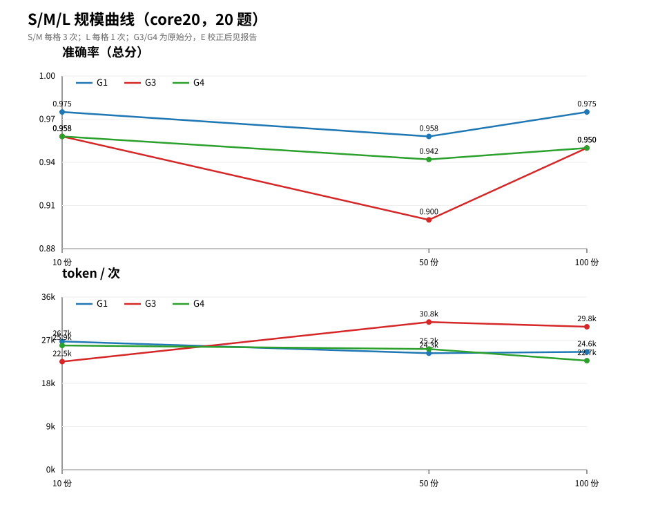

# pi CLI 文档检索基准：S/M/L 三档评估报告

> 日期：2026-11-04/05  
> 模型：`deepseek/deepseek-flash`（`DeepSeek-V4.1-Flash-1017`）  
> 任务书：`docs/task.md`（修订版）；原任务书归档 `docs/archive/task_book_original.md`  
> 范围：core20 试点（20 题），S10 / M50 / L100；S/M 主要组 3 次，L 与 hybrid 1 次  
> 结论级别：**试点级**，不是 163 题全量；规模按修订任务书 10–100 份，原任务书建议的 2000 份未采用

## 1. 结论

**在 10–100 份、20 题的当前范围内，纯 CLI（G1）是性价比最高的默认方案；向量 RAG 与混合组都没有证明出稳定增益。**

| 问题 | 结论 | 关键数字 |
|---|---|---|
| 哪类任务 CLI 就够 | A 精确事实、B 语义改写、C 跨文档汇总、E 无答案 | G1 S/M/L = 0.975 / 0.958 / 0.975 |
| 哪类必须上 RAG | 当前没有；规模变大后 B/C 是候选 | G3 没有稳定超过 G1 |
| 混合怎么搭 | 默认 G1；`search_docs` 按需接入，`k=5` 起步 | G4 没有打赢 G1 |
| 上下文成本 | G0 不划算 | M 档 439k token/次，约 G1 的 18 倍，分数反低 0.008 |
| 压缩 | 正常不触发；反复压代价高 | 700 次正常 0 次；12 次压缩耗时 17.6 倍 |
| 本地 Ollama | 能连，但不能用 | qwen2.5/deepseek-r1 0.200；qwen3.5 0.000 |

一句话：

> 只给 pi 原生 CLI 工具，在 10–100 份公开年报上已经够用；RAG 的价值要等语料和语义改写比例继续上升才会显现，当前数据回答不了“哪个规模必须上 RAG”。

## 2. 实验设置

| 项 | 值 |
|---|---|
| pi | 1.4.0 |
| 被测模型 | `deepseek/deepseek-flash`（1M 上下文），temperature=0，thinking=off |
| 判分器 | Kimi 判 A/B/C/E；DeepSeek V4 Pro 判 D；应拒题走规则 |
| 语料 | 巨潮资讯 2025 年度报告摘要，公开资料 |
| 题集 | 163 题（A70/B42/C22/D19/E10）；实验用 core20（A5/B5/C5/D2/E3） |
| 运行 | 每题 1 次（L/hybrid）或 3 次（S/M 主要组）；`--no-session`，每题干净上下文 |
| 隔离 | G1/G1+/G3 只读；G2/G4 专用目录 + guard + 事后审计，不是容器 |
| 复现 | 由第二人独立执行；脚本 `scripts/reproduce_core20.ps1`（core20 ×3）；协议见 `report/reproduction.md`；当前待安排 |

### 2.1 语料

| 档 | 文档数 | 字节 | 字符 | 页 | 嵌套 |
|---|---:|---:|---:|---:|---|
| S | 10 | 382,966 | 149,128 | 153 | S ⊂ M |
| M | 50 | 1,722,556 | 686,615 | 733 | M ⊂ L |
| L | 100 | 3,036,077 | 1,229,436 | 1,322 | — |

**语料采集**：语料由自研的 `cninfo-summary-crawler` 从巨潮资讯网公开披露中采集。程序按“年度报告摘要”检索 2025 年 A 股年报摘要，过滤半年度、英文版、取消/更正公告和 ST 公司，同一公司同一报告期保留最新版本；下载 PDF 后用 `pypdf` 逐页提取文本层，保留 `<!-- page: N -->`、来源 URL、抓取时间、sha256、页数和字符数，输出单文件 Markdown、合并包和 `manifest.jsonl`。程序不调用 LLM，不做摘要、改写或翻译。最终得到 100 份摘要（3.04 MB / 1,322 页），按 S10/M50/L100 构造嵌套语料。工具源码见 `tools/cninfo-summary-crawler/`。

### 2.2 组别

| 组 | 工具 | 说明 |
|---|---|---|
| G0 | 无 | 语料整篇塞入；L 放弃 |
| G1 | read/grep/find/ls | 主实验组 |
| G1+ | G1 + INDEX/AGENTS | 目录索引 |
| G2 | G1 + bash | 专用目录 + guard |
| G3 | read + search_docs | 向量 RAG |
| G4 | G2 + search_docs | 工具级混合 |
| G3h/G4h | 同上，hybrid 检索 | dense + BM25，1 次重复 |

**隔离边界（G2/G4）**：原任务书要求带 bash 的组在容器或只读挂载中运行。本机是 Windows 11，没有 Docker Desktop，WSL2 未确认可用，因此 G2/G4 实际采用 **专用目录（`<isolated-corpus>/M/L`）+ `corpus_guard` + `bash_guard` + 关闭 `edit/write` + 事后审计**，不是容器，也不是 OS 级只读挂载。已跑结果的成功越界 0、拦截 0、答案引用外部路径 0；但该方案是启发式防护，残余风险包括 guard 可被绕过、隔离目录内可写、网络未限制。详见 `isolation.md`。

## 3. 主结果

主表口径：**原始规则分**（判分器直接算，可复现）。E 校正只在附录。

| 格 | n | 总分 | token/次 | 秒/次 | 费用/次 |
|---|---:|---:|---:|---:|---:|
| G0 S | 60 | 0.975 | 94,673 | 3.4 | $0.0015 |
| **G1 S** | 60 | **0.975** | **26,738** | 8.6 | $0.0028 |
| G1+ S | 60 | 0.950 | 21,189 | 7.3 | $0.0026 |
| G2 S | 60 | 0.967 | 25,242 | 7.7 | $0.0027 |
| G3 S | 60 | 0.958 | 22,533 | 7.6 | $0.0031 |
| G4 S | 60 | 0.958 | 25,905 | 8.0 | $0.0027 |
| G3h S | 20 | 0.875 | 19,693 | 5.4 | $0.0016 |
| G4h S | 20 | 0.925 | 21,171 | 6.5 | $0.0013 |
| G0 M | 60 | 0.950 | 439,108 | 4.8 | $0.0031 |
| **G1 M** | 60 | **0.958** | **24,291** | 6.6 | $0.0019 |
| G1+ M | 60 | 0.933 | 28,942 | 6.9 | $0.0033 |
| G2 M | 60 | 0.967 | 27,728 | 8.4 | $0.0029 |
| G3 M | 60 | 0.900 | 30,788 | 6.9 | $0.0033 |
| G4 M | 60 | 0.942 | 25,158 | 6.6 | $0.0014 |
| G3h M | 20 | 0.925 | 19,420 | 5.6 | $0.0014 |
| G4h M | 20 | 0.950 | 25,383 | 10.6 | $0.0013 |
| G1 L | 20 | 0.975 | 24,562 | 6.6 | $0.0028 |
| G1+ L | 20 | 0.950 | 32,621 | 9.0 | $0.0019 |
| G2 L | 20 | 0.975 | 36,712 | 9.1 | $0.0025 |
| G3 L | 20 | 0.950 | 29,807 | 6.6 | $0.0017 |
| G4 L | 20 | 0.950 | 22,742 | 6.5 | $0.0015 |
| G3h L | 20 | 0.950 | 20,643 | 5.9 | $0.0015 |
| G4h L | 20 | 0.950 | 26,329 | 6.5 | $0.0014 |

分类别（原始分，全部 17 格；成本见上表或 `report/comparison_core20.csv`）：

| 格 | A | B | C | D | E | 总分 | 费用/次 |
|---|---:|---:|---:|---:|---:|---:|---:|
| G0 S | 1.000 | 0.933 | 1.000 | 1.000 | 0.944 | 0.975 | $0.0015 |
| G1 S | 1.000 | 1.000 | 0.967 | 0.833 | 1.000 | 0.975 | $0.0028 |
| G1+ S | 0.967 | 0.933 | 0.967 | 0.833 | 1.000 | 0.950 | $0.0026 |
| G2 S | 1.000 | 0.900 | 1.000 | 0.917 | 1.000 | 0.967 | $0.0027 |
| G3 S | 1.000 | 0.967 | 1.000 | 0.917 | 0.833 | 0.958 | $0.0031 |
| G4 S | 1.000 | 0.967 | 1.000 | 0.917 | 0.833 | 0.958 | $0.0027 |
| G0 M | 1.000 | 0.867 | 0.967 | 0.917 | 1.000 | 0.950 | $0.0031 |
| G1 M | 1.000 | 0.933 | 1.000 | 0.750 | 1.000 | 0.958 | $0.0019 |
| G1+ M | 0.967 | 0.900 | 0.967 | 0.833 | 0.944 | 0.933 | $0.0033 |
| G2 M | 1.000 | 1.000 | 1.000 | 0.750 | 0.944 | 0.967 | $0.0029 |
| G3 M | 0.967 | 0.933 | 1.000 | 0.750 | 0.667 | 0.900 | $0.0033 |
| G4 M | 0.967 | 1.000 | 1.000 | 0.667 | 0.889 | 0.942 | $0.0014 |
| G1 L | 1.000 | 1.000 | 1.000 | 0.750 | 1.000 | 0.975 | $0.0028 |
| G1+ L | 1.000 | 0.800 | 1.000 | 1.000 | 1.000 | 0.950 | $0.0019 |
| G2 L | 1.000 | 1.000 | 1.000 | 0.750 | 1.000 | 0.975 | $0.0025 |
| G3 L | 1.000 | 1.000 | 1.000 | 0.750 | 0.833 | 0.950 | $0.0017 |
| G4 L | 1.000 | 1.000 | 1.000 | 0.750 | 0.833 | 0.950 | $0.0015 |

> 分类别样本很小：A/B/C 每格 5 题，E 3 题，D 只有 2 题；类别分只用于看方向，不当成稳定排名。

主要观察：

1. **G1 在 S/M/L 都稳**，token 24–27k，是最均衡的默认；
2. **G0 不划算**：M 档 18 倍 token，分数还低；
3. **G3 没有打赢 G1**：M 档 0.900 是常规组最低，检索后还要 read 核对；
4. **G4 没有稳定收益**：S/M/L 与 G1 接近或更低；
5. **hybrid 只在 M 档小幅提升**：G3 0.900→0.925，G4 0.942→0.950；S 下降是 1 次重复的噪声；
6. **D 类是共同短板**（0.667–0.917，每个格只有 2 题）。

## 4. 规模曲线



数据：`report/scale_curve.csv`。

| 指标 | S（10 份） | M（50 份） | L（100 份） |
|---|---:|---:|---:|
| G1 总分 | 0.975 | 0.958 | 0.975 |
| G1 token/次 | 26.7k | 24.3k | 24.6k |
| G3 总分 | 0.958 | 0.900 | 0.950 |
| G3 token/次 | 22.5k | 30.8k | 29.8k |
| G3 recall page@5 | 1.000 | 0.913 | 0.830 |
| G3 recall page@10 | 1.000 | 0.986 | 0.928 |

- 检索页码命中随规模下降（1.000→0.913→0.830），但 Agent 用多轮检索 + read 补偿，答案分没有同步下降；
- 只覆盖 10→100 份；不扩 2000 份是主动决策，因此不能回答“哪个规模开始明显变差”。

## 5. 行为分析

### 5.1 CLI / RAG 的工具行为

- G3 的 120 次 S/M 运行**没有一次零检索直接答**；平均每题 2.9 次 `search_docs`，最多 11 次；
- `k` 偏好 8–10（10 出现 119 次、8 出现 101 次、默认 5 出现 53 次）；
- `read` 全部是分段读（带 offset/limit），没有整文件读；
- 回答同时带文件名和页码：G3 S 55/60、M 58/60；
- G4 S/M 的工具次数：search_docs 87/88、grep 68/69、read 57/52、bash 19/19、ls 63/65；
- G4/G2 审计：成功越界 0，外部引用 0。

### 5.2 典型轨迹

1. **G3 S q306（成功）**：两次 search_docs（k=10）命中倍轻松第 11 页，答出 7.35%；
2. **G3 M q375（E 规则偏差）**：明确拒答小米交付量，但补了蔚来/零跑交付量，规则判 0.5；主表仍按 0.5，附录人工记 1；
3. **G4 M q364（长任务）**：23 次工具、199k token，结构完整，但把估算值当结论，判 0.5。

完整 15 条见 `trajectories_core20.md`。

### 5.3 失败模式分类

| 失败模式 | 典型题 | 表现 | 影响 |
|---|---|---|---|
| 同名文件/错取公司 | q349（G0） | 把瀚川智能的数据当成铂力特 | A 类事实错误 |
| 数字取错/算术错 | q314、q342（G0） | 13.05% 是虚构；有原始数据却拒绝计算 | B/C 类 0 分 |
| 结论对但补充出错 | q322、q309、q360 | 多写背景、把原文有的说成“未披露” | 0.5 封顶 |
| 引用格式不规范 | q332、q359 | 答案对，但引用没带公司目录/相对路径 | `evidence_hit=0` |
| 长任务没有停止条件 | q318、q316 | 35/33 次工具，token 与耗时翻倍 | D 类成本高 |
| bash 耗尽输出预算 | q373（G2） | 达到输出上限，没有正文 | D 类 0 分 |
| E 类判分误伤 | q375 | 明确拒答，但补充“港股上市”被当外部信息 | E 类 0.5 |
| 全文注入仍然答错 | G0 q314/q342 | 1 轮 0 工具，照错 | G0 不划算 |

### 5.4 中文格式对 grep 的影响

控制探针（M 档）：

| 维度 | 命中/总数 | 说明 |
|---|---:|---|
| 简体无空格基线 | 7/7 | 正常 |
| 中文词间加空格 | 1/3 | 多数 0 命中 |
| 繁体查询 | 0/4 | 简体语料全 0 |
| 全角数字 | 1/2 | `２０２５` 0 命中；全角 `％` 少量存在 |
| 数字格式（去逗号/换单位） | 0/5 | `342,496,653.85` 与 `342496653.85` 不互通 |

真实轨迹（G1/G2/G4，420 次运行）：

- grep 678 次，0 命中 41 次（6.0%）；38/420 次运行至少一次 0 命中（9.0%）；
- 20% 的运行使用 ≥2 种 grep pattern（换词）；
- Agent 几乎不主动用繁体/全角写法；0 命中主要是 E 类“查不存在的主体”和少量 `&lt;!-- page:` 转义。

## 6. 上下文压缩

正常 700 次 core20 运行 **compaction 触发 0 次**（1M 上下文，20 题任务到不了阈值）。

强制压缩（`PI_CODING_AGENT_DIR` 单独 settings；提高 reserve、下调 keepRecent）：

| 题 | 基线分（3 次） | 压缩后 | 压缩次数 | 压缩前→后 token | 总 token | 耗时 |
|---|---:|---:|---:|---|---:|---:|
| q364 | 0.83 | 1.00 | 2 | 27.3k→9.3k；25.6k→8.4k | 127.7k | 34.9s |
| q318 | 0.67 | 0.50 | 1 | 27.5k→8.7k | 231.0k | 35.3s |
| q365 | 0.67 | 1.00 | 3 | 17.2k→6.1k；17.1k→6.6k；18.6k→6.6k | 154.1k | 67.2s |
| q318（极早） | 0.67 | 0.50 | 12 | 10.7k–17.5k→2.8k–8.7k | 293.4k | 348.1s |

- 单次压缩省 55%–76% 上下文；
- 3 个案例质量不降，1 个降到 0.5；反复压 12 次 token 2.2 倍、耗时 17.6 倍，分数没提高；
- 摘要会丢精确数字（q364 只保留 1/5 个关键数字），最终答案靠 kept recent messages 和重读兜底。

## 7. 局限性

1. **20 题试点**：分类别 n=5、D=2，类别差异可能是噪声；
2. **L/hybrid 1 次重复**：S/M 是 3 次，不能直接比方差；
3. **规模只到 100 份**：按修订任务书 L=100（原任务书建议约 2000 份，未采用），本报告不能回答规模拐点；
4. **163 题未全跑**：按决定只跑 core20；新增题中 63 条未人工复核；
5. **E 类主表用原始规则分**：规则会把“拒答+背景数字”判 0.5；人工核对只放附录；
6. **判分器偏差**：78 条人工复核中 72/78 完全一致；G4 S q365 出现自动高、人工低；D 类派生计算不稳；
7. **G2/G4 不是容器隔离**：专用目录 + 启发式 guard + 事后审计，残余风险见 `isolation.md`；
8. **模型单一**：只测 `deepseek/deepseek-flash`；Ollama 4B/7B 负结果见附录；
9. **hybrid 只验证了 1 次**：M 档小幅提升，不能写成“hybrid 更好”；
10. **费用含前缀缓存**：G0 的 $0.0031/次是缓存命中价，缓存 miss 时 M 约 $0.13/次；
11. **独立复现待第二人执行**：`scripts/reproduce_core20.ps1` 已提供（core20 ×3），复现协议见 `report/reproduction.md`；当前尚未安排第二人，因此本报告不声称“复现已通过”。执行时需要 Token/API 配额或本地大模型权限；
12. **G1 M 为旧任务复用**：M 档 G1 数据来自旧任务（归档在 `archive/old_source/runs/metrics.jsonl`），不是本轮全部新跑；语料 hash 与旧任务一致。

## 附录 A：E 类校正（不进入主表）

| 格 | 原始（主表） | E 校正（附录） |
|---|---:|---:|
| G3 S | 0.958 | 0.983 |
| G3 M | 0.900 | 0.950 |
| G3 L | 0.950 | 0.975 |
| G4 S | 0.958 | 0.983 |
| G4 M | 0.942 | 0.958 |
| G4 L | 0.950 | 0.975 |

## 附录 B：人工复核

| 组 | 完全一致 | 含 0.5 可接受 |
|---|---:|---:|
| G3 S | 19/19 | 19/19 |
| G4 S | 17/19 | 19/19 |
| G3 L | 18/20 | 20/20 |
| G4 L | 18/20 | 20/20 |
| **合计** | **72/78 = 92.3%** | **78/78** |

## 附录 C：Ollama 负结果

| 模型 | 工具调用 | 5 题自动分 |
|---|---:|---:|
| qwen2.5:7b | 0/5 | 0.200 |
| deepseek-r1:7b | 0/5 | 0.200 |
| qwen3.5:4b | 5/5 | 0.000 |

结论：能连、qwen3.5 能调工具，但答不对；不进入正式表。详见 `ollama_connectivity.md`。

## 附录 D：费用

| 项 | 金额 |
|---|---:|
| 前三阶段（报告口径） | 约 $1.59 |
| G3/G4 + L | $0.9841 |
| compaction | $0.0770 |
| hybrid | $0.2167 |
| **报告口径合计** | **约 $2.87** |
| **扣除 G1 M 复用旧运行** | **约 $2.77** |

## 附录 E：文件

```
docs/task.md                        修订版任务书（执行口径）
docs/archive/task_book_original.md  原任务书（仅参考）
report/final_report.md              本报告（替代阶段总结）
report/conclusion_q5.md             第 5 问
report/isolation.md                 隔离边界
report/scale_curve.svg              规模曲线
report/hybrid_core20.csv            hybrid 机读表
scripts/reproduce_core20.ps1        复现脚本（待第二人执行）
report/reproduction.md              独立复现协议与记录表
code/runs/matrix_core20.json        dense 矩阵
code/runs/matrix_hybrid.json        hybrid 矩阵
```
